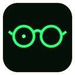

<p align="center"></p>

<h1 align="center">OpenGlasses</h1>

<p align="center"><b>AR-style AI overlay for your desktop.</b><br>
Select text or a screen region, press a hotkey, and the explanation appears right where you are looking.</p>

<p align="center"><i>Desktop software, not smart-glasses hardware.</i> · Windows 11 · MIT</p>

---

## What it does

OpenGlasses puts a transparent "lens" on your screen. You never leave the window you are working in:

| Hotkey | Action |
|---|---|
| `Alt+Q` | Explain the selected text, using the app and window as context |
| `Alt+W` | Freeze the screen, drag a box, and a vision model explains what is inside it (formulas, errors, diagrams, scanned PDFs) |
| `Alt+E` | *Experimental* doubt scan: the vision model points out up to 3 errors, jargon or formulas in the foreground window |
| `Ctrl+Alt+G` | Put the glasses on or take them off |

Answers stream in one of four styles. You can switch styles in Settings.

- **Lock-on** (default): corner brackets lock onto the selection, and a leader line leads to a short glowing summary. Hover over it to expand the full answer and ask follow-ups.
- **Lens Rail**: a slim panel docked at the screen edge, with a leader line back to the source and a short read-only history.
- **Caption**: one or two lines at the bottom of the screen, like subtitles on smart glasses.
- **Card**: the classic pop-up card.

Other features:
- A "Lens-On" focus animation plays when the glasses go on.
- A corner HUD shows CPU, RAM, GPU and VRAM, AI status, latency, tokens/s and today's token count.
- The visual theme is terminal green.
- Answers use your own API key, or a local model.

**Supported providers.** Any OpenAI-compatible endpoint works, including OpenAI, DeepSeek, Qwen (DashScope), OpenRouter, Ollama, vLLM and LM Studio. Anthropic Claude is supported natively.

## Themes

Themes are hot-swappable **theme packs**: a folder with `theme.json`, `theme.css` and optional SVG/PNG/font assets. Packs contain CSS and static assets only, never scripts. Three themes are built in:

| Theme | Look | Boot animation |
|---|---|---|
| **Terminal Green** (default) | Monochrome phosphor green, scanlines, a CRT flicker | The blurred desktop comes into focus |
| **Holo Blue** | JARVIS-style ice-blue HUD, chamfered panels, arc tick rings | Putting on glasses: sharp inside the lenses, blurred outside, then the whole screen comes into focus |
| **Cyber Neon** | Magenta and cyan neon, a one-shot glitch when answers appear | Neon power-on: RGB split, collapse to a line, then the desktop expands back |

Switch themes and the animation speed (Fast / Normal / Slow) under Settings → Appearance. To install a community theme, drop its folder into `%APPDATA%\io.github.youzilicc.openglasses\themes\` (or click **Open themes folder**). Edits to a theme's files apply live, with no restart.

**Making a theme:** read [`docs/THEMES.md`](docs/THEMES.md). You can preview the lens, the panel and the settings windows in any browser on any OS with [`dev/preview/`](dev/preview/README.md), no Windows needed.

## Status

`v0.1` MVP, Windows 11 only. See [`docs/DESIGN.md`](docs/DESIGN.md) for the full design. The original vision is in [`proposal.md`](proposal.md).

## Run from source

Prerequisites:
- Windows 11
- [Rust](https://rustup.rs) (stable)
- [Node.js](https://nodejs.org) 22 or newer
- pnpm (`corepack enable`)
- WebView2, which ships with Windows 11

```powershell
git clone https://github.com/YouZiliCC/OpenGlasses
cd OpenGlasses
pnpm install
pnpm tauri dev
```

On first launch the Settings window opens. Choose a provider, paste your API key and press **Test**.

Installers for each commit are produced by GitHub Actions. Open the CI run and download the artifact.

## Privacy

- **Zero telemetry.** Data goes only to the model provider you choose, and only when you press a hotkey.
- **No background capture.** OpenGlasses captures the screen only when you press a hotkey, to make the glass background and for the `Alt+W`/`Alt+E` image, and when it plays the Lens-On animation. Captures stay in memory and are never written to disk. Only the `Alt+W` and `Alt+E` images are sent to the model provider.
- **Your keys stay local.** API keys are stored in the Windows Credential Manager. The UI can set or clear a key, but it cannot read the key back.
- **Overlays are hidden from screen capture by default.** People watching a screen share or a recording will not see them. Turn this off in Settings if you want to record a demo.
- **Clipboard history caveat.** OpenGlasses first reads the selection through UI Automation, which leaves no trace. When an app does not support that, OpenGlasses copies the selection and then restores your clipboard. In that case the copied text appears once in Windows clipboard history (`Win+V`) and in cloud clipboard sync. Windows offers no way to prevent this.

## Known limitations (v0.1)

- Only Windows 11 is supported.
- Brackets and anchors do not follow content when you scroll it. A click or a window switch dismisses them.
- The doubt scan is experimental, and how accurate its box positions are depends on the model.
- In some apps a bare `Alt+<letter>` may still open the menu bar. If that happens, rebind the hotkey in Settings. Don't use `Ctrl+Alt+…`, because on many European keyboard layouts that combination is AltGr.

## Roadmap

- **v0.3**: context widgets, native Acrylic panels, more GPU vendors in the HUD.
- **v0.6**: an opt-in proactive "doubt radar" that detects stalls and changes on screen.
- **v1.0**: HUD widget plugins and lens themes.

## License

[MIT](LICENSE)

---

## 中文简介

**OpenGlasses**：给你的电脑桌面戴上一副 AI 眼镜。选中文字或框选屏幕区域，按一个热键，解释会以 AR 叠加的方式出现在原位，不需要切换窗口。

- 热键：`Alt+Q` 解释选中文字，`Alt+W` 框选截图，`Alt+E` 疑点扫描（实验性），`Ctrl+Alt+G` 戴上或摘下眼镜。
- 呈现风格有四种：锁定标注（默认）、镜片侧栏、字幕带、经典卡片。
- 四角 HUD 遥测：CPU / 内存 / GPU / 显存 / AI 状态。
- 主题支持热插拔，主题包只含 CSS 和素材。内置三个：终端绿光（模糊到清晰的对焦动画）、全息蓝（戴上眼镜：镜片内清晰、镜片外模糊，最后整屏清晰）、赛博霓虹（霓虹通电）。动画速度可在设置里调整。写主题请看 [`docs/THEMES.md`](docs/THEMES.md)。
- 模型使用你自己的 API Key，支持 OpenAI 兼容接口（含 DeepSeek、通义、OpenRouter、Ollama）和 Anthropic Claude。
- 隐私：零遥测；只在按热键或播放 Lens-On 动画时截屏，截图只保存在内存中，只有 `Alt+W` 和 `Alt+E` 的截图会发给模型；API Key 存在 Windows 凭据管理器；叠加层默认不会被录屏捕获。

设计文档见 [`docs/DESIGN.md`](docs/DESIGN.md)。
